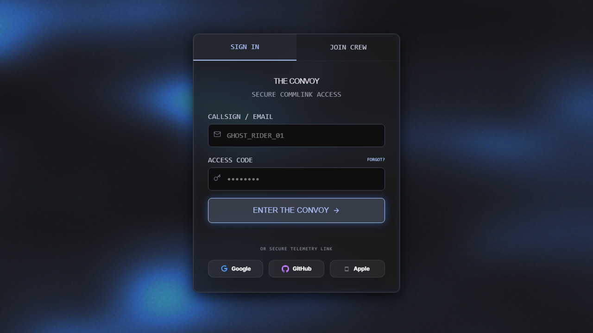
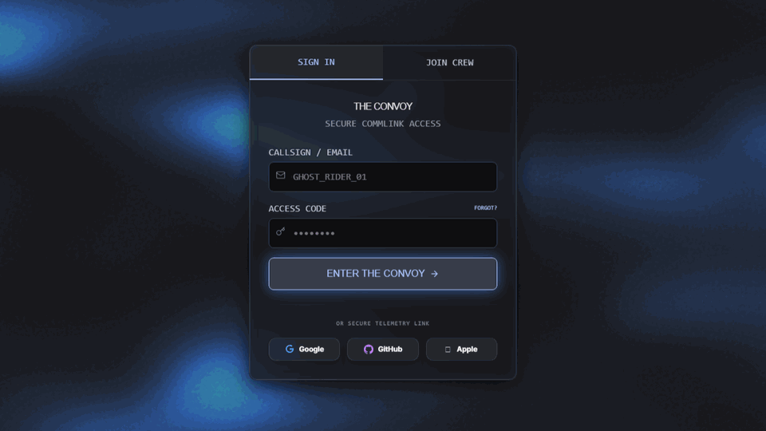

# Convoy Coordinator 🚗📍

A real-time fleet synchronization and convoy routing application built with **React**, **Node.js / Express**, **Socket.io**, **Mapbox GL**, and **Capacitor Android**.

Designed for road trips, delivery fleets, and organized group travel, Convoy Coordinator ensures members stay synchronized on live interactive maps with millisecond WebSocket location updates, convoy ledger expense splitting, and cross-platform mobile compatibility.

---

## 📸 Preview & Live Walkthrough





> 🎬 **[Watch Full Demo Video (WebM)](./docs/demo.webm)**

---

## 🌟 Key Features

* **Live Real-Time Mapbox Tracking:** High-precision GPS marker updates via bidirectional WebSockets (`socket.io`).
* **Convoy Fleet Management:** Create and join trip convoys with invite codes, real-time participant status, and destination routing.
* **Shared Expense Ledger:** In-app expense ledger to track shared fuel, toll, and food expenses among convoy members.
* **Mobile-Ready Architecture:** Packaged with **Capacitor Android** for native mobile performance and tactile navigation.
* **Fluid UI/UX:** Built with React, Tailwind CSS, Lucide Icons, and Framer Motion for smooth transitions.

---

## 🛠️ Tech Stack

* **Frontend:** React 18, Vite, Mapbox GL JS, Tailwind CSS, Framer Motion, Lucide React
* **Mobile Runtime:** @capacitor/core, @capacitor/android
* **Backend:** Node.js, Express.js, Socket.io, Mongoose (MongoDB), JWT Authentication, bcryptjs
* **Database:** MongoDB

---

## 🚀 Quick Start Guide

### 1. Prerequisites
* Node.js (v18+)
* MongoDB running locally or MongoDB Atlas connection string
* Free Mapbox API token ([mapbox.com](https://www.mapbox.com))

### 2. Backend Setup
```bash
cd backend
npm install
# Configure your .env file with PORT, MONGO_URI, and JWT_SECRET
npm run dev
```

### 3. Frontend Setup
```bash
cd frontend
npm install
# Set VITE_MAPBOX_TOKEN in your frontend .env
npm run dev
```

---

## 📱 Android Build (Capacitor)
```bash
cd frontend
npm run build
npx cap sync android
npx cap open android
```

---

## 🛡️ License
MIT License. Built by Yash P Chavan.
